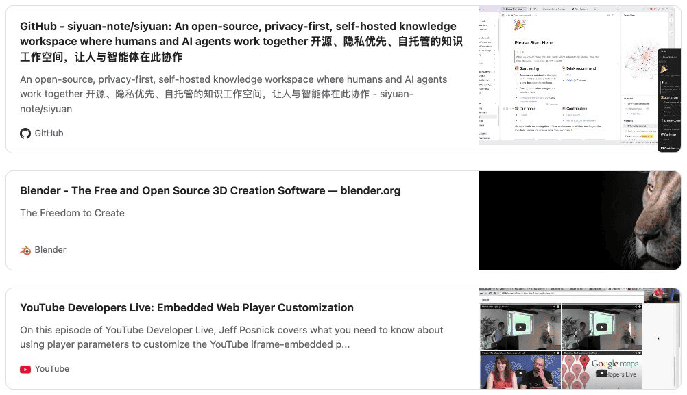
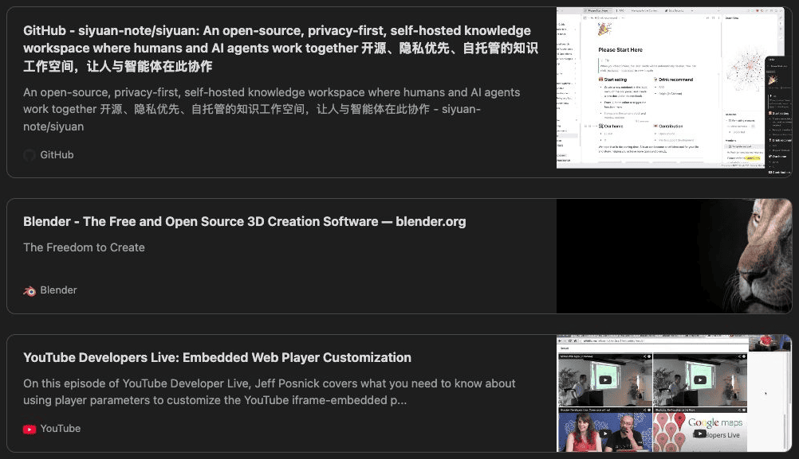
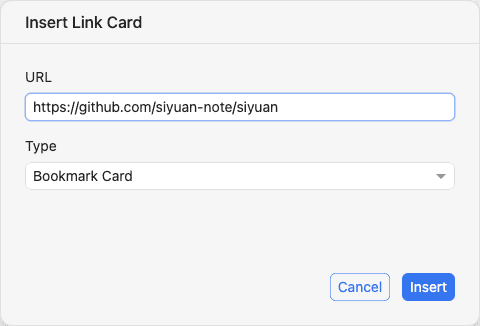

# SiYuan Link Cards

[Deutsch](README.de-DE.md)

Passive rich Link Cards and native YouTube embeds in SiYuan. Bookmark and supported oEmbed
link/photo cards share one responsive layout and save their metadata in the document.
Choose Link Card for a passive snapshot or Embed for a supported playable YouTube video.



## Features

- One responsive passive card layout for bookmarks, including YouTube URLs, and oEmbed links/photos.
- Native responsive YouTube embeds from ordinary video URLs; no iframe HTML to copy.
- Optional description, preview image and site/provider identity, in light and dark themes.
- Bookmark and Embed insertion through two Slash actions and one Link Card selection-toolbar action.
- English and German interface, URL prefill and native Undo/Redo.
- Saved JSON remains readable when the plugin is disabled.



## Creating Link Cards

Type `/linkcard`, `/bookmark` or `/card`, choose **Insert Link Card**, check the URL and click **Insert**.
The plugin reads Open Graph, Twitter or HTML metadata. Select a URL and use the Link Card toolbar
button or **Link Cards: Insert Bookmark Card** in the Command Palette to retain its prefill.
The same dialog lets you switch between **Bookmark Card** and **Embed** without losing the URL.
Cancel inserts nothing. If metadata cannot be resolved, you can explicitly choose a simple card
with the URL and hostname.



## Embed with oEmbed and YouTube

Use `/embed` or `/oembed` to open the shared dialog with **Embed** selected. A supported normal
YouTube URL is verified and inserted as a native SiYuan iframe block, with responsive 16:9 sizing.
SiYuan owns the player; no plugin video card or **Load video** step is created for new embeds.
Active video embedding is **YouTube-only**. No provider-returned HTML is executed.

Supported sources are HTTPS `youtube.com/watch?v=ID`, `www.youtube.com/watch?v=ID` and `youtu.be/ID`.
You do not need to obtain or paste iframe HTML. Source share parameters are not copied into the
player URL. Shorts, live and playlist links remain unsupported. Unsupported content/frontends
can use the explicit **Bookmark Card** fallback; there is no automatic conversion.

For the same YouTube URL, `/card`, `/bookmark` or `/linkcard` creates an ordinary **passive Link Card**.
Safe JSON oEmbed **link** and **photo** results also remain passive cards, not native iframes.


## Local preview assets

All passive cards show the real site favicon when available, with a neutral globe fallback otherwise.
New Bookmark preview images and passive-card favicons are imported into SiYuan assets when possible.
PNG, JPEG and WebP are supported; unsupported media or a failed optional import is omitted without
blocking the card. Rendering never refreshes metadata or imports assets. Files can be shared between cards and remain
after Undo or card deletion; use SiYuan's normal asset management for unused files.

## Privacy and network behavior

- Page metadata is requested only after **Insert** or explicit favicon-repair confirmation. Rendering does not refresh it.
- New Bookmark media is localized where possible. Existing remote snapshots remain compatible;
  their images, oEmbed photos and YouTube thumbnails may contact external hosts while rendering.
- New native YouTube embeds can contact YouTube whenever SiYuan renders or reloads the block,
  before you press Play. Choosing **Embed** authorizes this active content; choose **Bookmark Card**
  for a passive metadata snapshot instead. No autoplay parameter is added.
- Existing video-v1 cards retain their **Load video** activation boundary; thumbnails can load earlier.
- No arbitrary provider iframe HTML, scripts or srcdoc are inserted.
- There is no automatic paste conversion or background metadata crawler.

Use links you trust. Network availability and access restrictions depend on SiYuan and the provider.

## Compatibility and limitations

Requires **SiYuan 3.8.3+**. Mobile, export and encrypted-notebook workflows are not verified.
Only advertised JSON oEmbed is supported; XML, rich HTML and other video providers are unsupported.
The native selection toolbar appears for selected text; use the Command Palette with only a caret.
Metadata is a saved snapshot, not a live page view.

Existing video cards retain their preview/**Load video** behavior and are not automatically rewritten.

## Installation

Download `package.zip` from a published [GitHub Release](https://github.com/blacknet76/siyuan-link-cards/releases).
Extract its contents directly into your workspace's `data/plugins/siyuan-link-cards/` directory,
then enable **Link Cards** under **Settings → Marketplace → Downloaded**. Reload SiYuan after an
update. When listed, the plugin can also be installed through the Marketplace.

## Maintenance

Older or migrated cards can predate favicon import. Focus an editable note and use
**Link Cards: Repair missing favicons…** in the Command Palette. The aggregate preview is local and
read-only; only explicit confirmation contacts the saved source websites and repairs missing or
structurally unusable favicons. Existing favicons and all other metadata remain unchanged.

## Legacy migration

For compatible historical `embed` Link Card code blocks, focus an editable note and use
**Link Cards: Migrate legacy Link Cards…** in the Command Palette. Review the workspace scan and explicitly confirm the migration. Unknown or
ambiguous formats are skipped; optional unsupported media may be omitted. Migration keeps block
IDs and uses saved titles and descriptions without refreshing page metadata. Confirming can download
saved media solely for local import. Native Undo is per card and subject to SiYuan's temporary history;
keep a backup before migrating important notes. Nothing migrates automatically.

Older supported YouTube embeds can be explicitly converted to native SiYuan embeds using
**Link Cards: Migrate legacy YouTube embeds…** in the Command Palette. Review and confirm the preview;
block identity and native Undo/Redo are preserved.

## Development

Requires Node.js 24+:

```sh
npm ci
npm run typecheck
npm run lint
npm test
npm run format:check
npm run build:dev
npm run package
```

`npm run dev` watches the source into `dev/`. Production builds create `dist/` and `package.zip`.
Build output is ignored in Git; `package.zip` is distributed as a GitHub Release attachment.
The package is not intended for npm publication.

## License

[MIT](LICENSE). See [third-party notices](THIRD_PARTY_NOTICES.md) for the SiYuan build conventions
and development dependencies.
